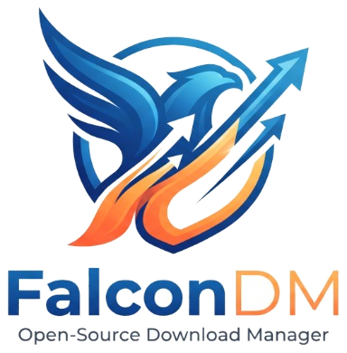
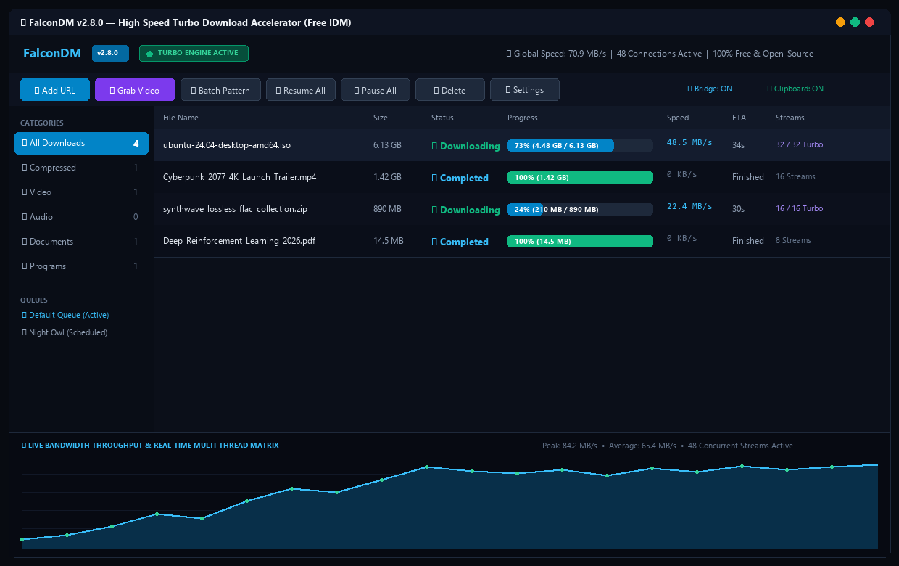

<div align="center">
  
  <h1>⚡ FalconDM v2.8.0</h1>
  <p><strong>The Ultimate Free & Open-Source IDM Alternative</strong></p>
  <p>
    <a href="https://github.com/rakib015/FalconDM/releases/tag/v2.8.0"></a>
    
    
    
  </p>
</div>

**FalconDM** is a high-speed, feature-packed, 100% free download accelerator, media grabber, and multi-protocol bridge built from the ground up to match and exceed the capabilities of Internet Download Manager (IDM), aria2, JDownloader 2, and Motrix.



---

## 🌟 What Makes FalconDM Better Than IDM?

| Feature | Internet Download Manager (IDM) | FalconDM (FreeIDM) |
|---|---|---|
| **Price & License** | $24.95 / Paid Trialware | **100% Free & Open-Source Forever** |
| **Multi-Threaded Turbo Engine** | Up to 32 Connections | **Up to 32 Connections (HTTP/1.1 Range)** |
| **Dynamic Segment Dividing** | Yes | **Yes (Auto-divides slow chunks dynamically)** |
| **File Assembly / Merging Delay** | Slow disk-thrashing merge step | **Instant Zero-Copy (Sparse pre-allocated offsets)** |
| **Video & Media Sniffer** | Browser Extension | **Universal Grabber (YouTube, TikTok, X, Reddit, 1000+ sites)** |
| **Browser Integration** | Native messaging extension | **Local Webhook Bridge (127.0.0.1:9666) + Userscript** |
| **Clipboard Auto-Sniffing** | Yes (Pop-up dialog) | **Yes (Background sniffer with one-click prompt)** |
| **Batch Pattern Downloader** | Yes | **Yes (`[01-20]` range syntax & multi-line paste)** |
| **Checksum / Hash Verifier** | None | **Built-in MD5, SHA-1, SHA-256 validator** |
| **User Interface** | Outdated 2005 Windows 98/XP look | **Modern Cyberpunk Dark Obsidian UI (CustomTkinter)** |

---

## 🚀 Key Modules & Capabilities

### 1. ⚡ Turbo Multi-Threaded Engine (`core/engine.py`)
- Slices files into **4, 8, 16, or 32 concurrent byte streams**.
- Bypasses ISP & per-socket TCP window limits for maximum bandwidth saturation.
- **Dynamic Segment Splitting**: If some threads finish downloading earlier than others, the engine automatically splits the slowest remaining chunk in half so all threads stay busy until the final megabyte.
- **Bit-Exact Resumption**: Automatically saves chunk progress to `downloads.json`. Pause anytime and resume without losing a single byte.

### 2. 🎬 Universal Video & Media Grabber (`core/media_grabber.py` & `gui/dialogs.py`)
- Click **"🎬 Grab Video"** or paste any video link:
  - **YouTube, Twitter / X, TikTok, Reddit, Instagram, Facebook, Vimeo, Twitch, Soundcloud**, and 1,000+ platforms.
- Automatically probes title, duration, author, and available resolutions:
  - `1080p (MP4)`, `720p (MP4)`, `480p (MP4)`, or `Audio Only (MP3)`.

### 3. 🌐 Browser Integration & Webhook Bridge (`core/browser_bridge.py`)
- FalconDM runs an ultra-fast local Webhook Server on `http://127.0.0.1:9666`.
- Any browser extension or userscript can send downloads to FalconDM with one click!
- Comes bundled with [`falcon_browser_extension.user.js`](file:///e:/CODE/FalconDM/assets/falcon_browser_extension.user.js):
  - Adds floating **"⚡ Download with FalconDM"** button on video pages.
  - **Alt + Click** on any file link to immediately download via FalconDM!

### 4. 📋 Background Clipboard Sniffer (`core/clipboard_watcher.py`)
- Monitors Windows clipboard in the background.
- When you copy any download URL (`.zip`, `.rar`, `.exe`, `.mp4`, `.pdf`, `.iso`, etc.) or video link in your browser, FalconDM instantly pops up to start the download.
- Toggle ON/OFF anytime from the top-right toolbar switch.

### 5. 📦 Batch Downloader & Pattern Grabber (`core/batch_manager.py`)
- Download entire file sequences using pattern bracket syntax:
  - `https://example.com/files/part[01-20].rar`
  - `https://cdn.site/album[1-5]/photo[001-010].jpg`
- Or paste 50+ lines of raw URLs and queue them simultaneously.

### 6. 🔍 Checksum & File Integrity Verifier (`core/hasher.py`)
- Calculate **MD5, SHA-1, and SHA-256** checksums of any downloaded file.
- Paste expected hash from a software vendor to instantly verify that the file is 100% authentic and uncorrupted.

### 7. 🕷️ Recursive Site Grabber & Media Sniffer (`core/site_grabber.py`)
- Multi-depth crawler (Depth 1: Single Page, Depth 2: Child Pages, Depth 3: Deep Crawl) with domain boundary rules.
- Concurrent HTTP HEAD size prober displaying exact remote file sizes (`MB`/`GB`) in the GUI before downloading.
- Deep extraction for CSS `url(...)`, `<link rel="preload">`, lazy `data-*` attributes, and `<script>` media links.
- Instant live search & wildcard filter (`*.pdf`, `episode*.mkv`).

### 8. 🌐 Web Remote & Mobile Dashboard (`http://127.0.0.1:9666/remote`)
- Control FalconDM from any mobile phone or browser on your local network.
- Live real-time download monitoring, start/pause/delete controls, and one-click remote download injection.

### 9. ☁️ Direct Cloud Host Resolvers (`core/host_resolvers.py`)
- Direct high-speed download extraction for **Google Drive** (bypassing confirmation tokens), **Dropbox**, **MediaFire**, **PixelDrain**, and **GitHub**.

### 10. 🛡️ Windows Defender Antivirus Auto-Scanner (`core/antivirus_scanner.py`)
- One-click and post-download scanning via `MpCmdRun.exe` or custom antivirus CLI commands.

### 11. 📦 Archive Auto-Unpacker (`core/archive_unpacker.py`)
- Automatically extracts `.zip`, `.rar`, `.7z`, and `.tar.gz` archives with saved password dictionary matching.

### 12. ⏱️ Bandwidth Scheduler & Night Owl Mode (`core/bandwidth_scheduler.py`)
- Automatically uncaps speeds during night hours and schedules bandwidth throttling during peak daytime work hours.

### 13. 📄 IDM (.ef2) & aria2 Import/Export (`core/import_export.py`)
- Seamless two-way migration of download queues to and from Internet Download Manager (`.ef2`) and aria2.

### 14. 🔔 Discord & Telegram Webhook Alerts (`core/webhook_notifier.py`)
- Dispatches rich embed notifications to your phone when large downloads complete or fail.

### 15. 💻 Full Headless CLI Engine (`core/cli.py`)
- Run FalconDM entirely from terminal or server environments without GUI dependencies:
  - `python main.py download <URL> [-c 16] [-o <DIR>]`
  - `python main.py list`
  - `python main.py site-grab <URL> [-d 2]`
  - `python main.py hash <FILEPATH>`

### 16. ⚡ Turbo Resilience & Stalled Stream Auto-Kick (`core/engine.py`)
- **Proactive Stall Kicker**: Detects hung sockets/stalled CDN connections (0 KB/s for 8s) and auto-kicks the socket for instant reconnect without aborting other active streams.
- **TCP Socket Tuning**: `TurboHTTPAdapter` applies `socket.TCP_NODELAY` to eliminate packet buffering latency and 512KB socket receive buffer.
- **Multi-Mirror Failover**: Configure fallback mirror URLs for seamless failover if a primary host returns 403/404 or drops.

### 17. 🎯 Queue Priorities & Reordering (`core/state_manager.py` & `gui/app.py`)
- Reorder queued tasks anytime with `Alt+Up`, `Alt+Down`, Move to Top, or Move to Bottom.
- Set task priority: **High (⚡)**, **Normal (•)**, or **Low (↓)**. The concurrency scheduler automatically launches high-priority downloads first.

### 18. 🎬 Media Grabber Pro with 4K/60fps & Subtitle Ripping (`core/media_grabber.py`)
- Detects **4K UHD (2160p 60fps)**, **2K QHD (1440p)**, and high-framerate streams across 1,000+ sites.
- Audio ripping presets: 320kbps MP3, 256k M4A (AAC), and Lossless FLAC.
- One-click **Closed Captions & Subtitles (`.srt`) extraction**.

### 19. 📊 IDM-Style Segment Thread Matrix Bar (`gui/download_window.py` & `gui/app.py`)
- Real-time multi-thread visual file map showing each connection's byte chunk, downloaded progress, and active downloading head glow.

### 20. ⚡ Zero-Lock High-Throughput Disk I/O (`core/engine.py`)
- Eliminates thread lock contention during multi-connection downloading. Each worker thread streams directly to its independent byte offset without serializing disk writes, saturating gigabit fiber connections.

### 21. 🎬 Sequential Stream Mode & Live VLC Preview (`core/engine.py` & `gui/app.py`)
- Prioritizes container headers (head) and metadata/cues (tail) before sequentially streaming the file.
- Click **"🎬 Play in VLC"** right in the floating download window or right-click context menu to start watching movies/videos in real-time before the download completes.

### 22. 🌙 Windows Sleep Prevention (`core/platform_utils.py` & `core/state_manager.py`)
- Integrates with the Windows `SetThreadExecutionState` API to prevent the operating system from going to sleep or hibernating during active downloads, ensuring uninterrupted overnight downloads.

### 23. 🔔 Native Auditory Notification Chimes (`core/platform_utils.py`)
- Plays subtle, non-intrusive notification chimes upon download completion or error using native Windows audio APIs with zero external dependencies.

### 24. 🗂️ Smart URL-to-Folder Destination Rules (`core/state_manager.py`)
- Configure pattern, domain, or extension rules to automatically route specific downloads to custom target directories (e.g. `github.com` -> `C:\DevTools`).

### 25. 🔓 Click'n'Load v2 Web Integration (from JDownloader 2 & pyLoad)
- FalconDM natively handles `/flash/addcrypted2` and `/flash/add` web endpoints.
- Click any "Click'n'Load" button on web file lockers and hosters, and FalconDM will automatically decrypt (AES-128-CBC) and queue the download links.

### 26. 🌉 aria2 & Motrix Universal JSON-RPC Bridge (from aria2 & Motrix)
- Universal JSON-RPC listener (`/jsonrpc` and `/rpc`) running on ports `6800`, `9666`, and `15151`.
- Any browser extension, WebUI, or script designed for aria2, Motrix, or WebUI-aria2 can communicate directly with FalconDM.

### 27. 📥 RFC 5854 Metalink 4 (.meta4 / .metalink) Engine (from aria2 & Wget)
- Import multi-mirror, multi-checksum Metalink files.
- Automatically pools high-speed geographic mirrors and verifies cryptographic checksums post-download.

### 28. 📋 1-Click "Copy as cURL Command" (from Chrome DevTools & IDM)
- Right-click any download or open File Properties to copy the exact `curl` command with user headers, authentication, cookies, and user agent.

### 29. 🧲 BitTorrent & Magnet Swarm Engine Pro (`core/torrent_engine.py`)
- Automatically injects Tier-1 public high-speed BitTorrent trackers (`udp://tracker.opentrackr.org`, `open.stealth.si`, etc.) and DHT bootstrap entry points.
- Instant peer discovery, DHT swarm resolution, PEX (Peer Exchange), and metadata-only torrent preview.

### 30. ⚡ Auto-Speed Optimizer (`core/engine.py`)
- Measures server round-trip latency (TTFB) and network responsiveness dynamically during probe.
- Automatically scales connection pool (8 vs 16 vs 32 turbo threads) based on bandwidth-delay product and host constraints.

### 31. 🎨 Cyberpunk Accent Themes & Custom Palettes (`core/config_manager.py` & `gui/app.py`)
- Switch instantly between 5 themes: **Cyberpunk Cyan**, **Emerald Matrix**, **Sunset Orange**, **Vaporwave Violet**, and **Crimson Turbo**.
- Real-time accent synchronization across toolbar actions, category badges, and dynamic throughput waveform graphs.

### 32. 📦 1-Click Browser Extension Store Packages (`build_extension_packages.py`)
- Automated store packager generating clean, compliant `.zip` archives for **Chrome Web Store**, **Microsoft Edge Add-ons**, and **Mozilla Firefox AMO** with full submission guides.

---

## 💻 Quick Start

### 1-Click Launch (Windows)
Double-click `run_falcondm.bat`.

### 🪶 Ultra-Lightweight / Low-Spec PC Mode (RAM: ~15–20 MB | CPU Idle: 0.0%)
For low-end PCs (2GB–4GB RAM, dual-core Celeron/Pentium/Atom, older laptops):
- Double-click `run_falcon_light.bat` (or run `python main.py --tray`).
- FalconDM starts silently into the Windows System Tray.
- Working set memory is dynamically trimmed via Windows `EmptyWorkingSet` down to **~15–20 MB**.
- Skips heavy GPU/canvas redraws and idles at **0.0% CPU**.
- The browser webhook bridge (`http://127.0.0.1:9666`) remains 100% active to capture downloads from Chrome/Edge/Firefox with full multi-threaded turbo speed.
- Double-click the tray icon anytime you want to see the full UI!

### 🌐 1-Click Browser Extension Setup (100% Free - No Store Fee Needed)
FalconDM includes a native browser extension for Chrome, Edge, Brave, Opera, and Firefox without requiring the $5 Chrome Web Store developer fee:
1. Simply double-click `install_extension.bat` (or run `install_extension.ps1`).
   - Automatically registers the Windows Native Messaging Host.
   - Copies the extension folder path to your clipboard.
   - Opens your browser's extension page (`chrome://extensions`, `edge://extensions`, etc.).
2. In your browser:
   - Turn ON **Developer mode** (toggle in top-right corner).
   - Click **Load unpacked** (top-left).
   - Press **Ctrl + V** in the folder bar and hit **Enter**!
3. That's it! FalconDM will now intercept downloads automatically and overlay the floating video grabber.
*(You can also click "1-Click Auto Install" directly inside the FalconDM app under Browser Extension Setup or from the Web Hub at `http://127.0.0.1:9666/`).*

### Or via Terminal
```powershell
python main.py
```

### Run Automated Tests (33/33 Tests Passed)
```powershell
# Run the complete test suite:
python test_features.py
```

